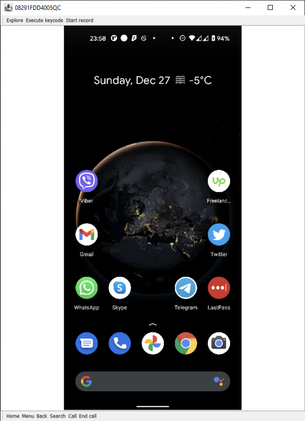
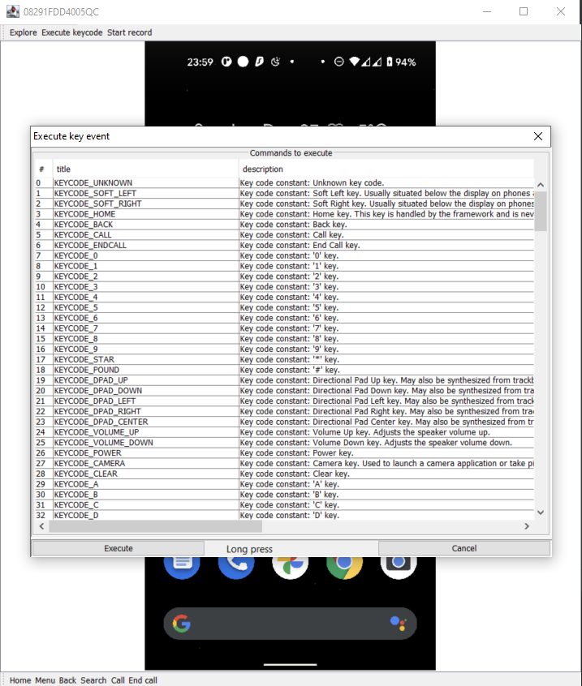

AndroidScreencast - <a href="https://github.com/xSAVIKx/AndroidScreencast/releases/latest"><i>download latest</i></a>
=================

# Description

AndroidScreencast was developed to view and control your android device from a PC.

This project gives the opportunity to use your phone even with a broken screen.

The main screen:

Commands execution screen:

Video recorded by the app available [here](./assets/androidscreencast.mov).

## Features

- No client needed
- Support for Tap and Swipe gestures
- Write messages using PC keyboard
- Support for landscape mode
- Browse your phone files on PC
- Record video of your phone screen while browsing

[Small wiki of project][wiki]

[wiki]: https://github.com/xSAVIKx/AndroidScreencast/wiki

## Download

Download a packaged build from the [releases page][releases]. Each release
provides an executable JAR and archives for Linux, macOS, and Windows.

[releases]: https://github.com/xSAVIKx/AndroidScreencast/releases

# Requirements

Currently, AndroidScreencast works directly with `adb input` program through `ddmlib` and uses functionality of:

- `adb input key`
- `adb input tap`
- `adb input swipe`

Regarding this point, to use AndroidScreencast you need Smartphone running on Android with specific `input`
program version. `adb input tap` and `adb input swipe` were introduced in [Android 4.1.1][Android_4_1_1_Input].

So, right now AndroidScreencast support all Android versions equal or greater than Android 4.1.1.

Also, to run AndroidScreencast you will need *adb* installed (or you can use bundled in OS bundles adb).

[Android_4_1_1_Input]: http://grepcode.com/file/repository.grepcode.com/java/ext/com.google.android/android/4.1.1_r1/com/android/commands/input/Input.java#Input

# More info

Please refer to the project's [GitHub page][github] for more detailed overview and specific instructions.

[github]: https://github.com/xSAVIKx/AndroidScreencast
